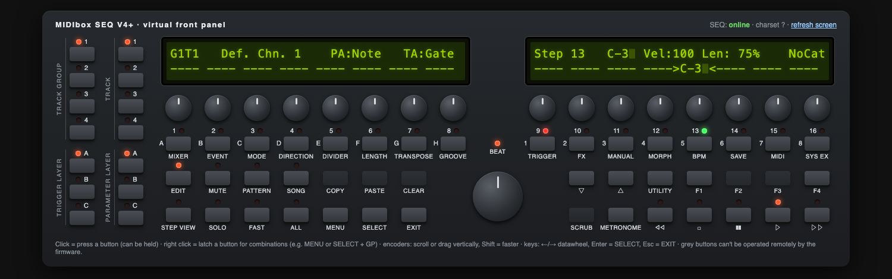

# MIDIbox SEQ V4+ emulator for macOS

Runs the **unmodified MIDIbox SEQ V4+ firmware** (`../core`: all pages, the sequencer, file handling) together with the
MIOS32 common code (MIDI, SRIO, DIN/DOUT/ENC, LCD) as a normal macOS program, with a virtual front panel in the browser.
Useful to try the SEQ without hardware, and to develop and test firmware changes without flashing a core.

It is plain C + pthreads + CoreMIDI and a small Python script for the panel: no Xcode project, no JUCE.
(The older `../macos` Xcode project uses PYMIDI and a Cocoa UI; this is a separate, command line based approach.)



## Requirements
- macOS with the Xcode command line tools (`xcode-select --install`: `clang`, `make`). Tested on macOS 15 (Apple Silicon), Apple clang 17.
- Python 3 with `mido` and `python-rtmidi`: `pip3 install mido python-rtmidi`.

## Use
```
cd apps/sequencers/midibox_seq_v4/emu_macos
make                 # about 1 minute the first time
./run.sh             # emulator + virtual panel on http://127.0.0.1:8766/  (Ctrl-C stops both)
```
- The first start creates `sdcard.img` (256 MB FAT32 image) with the folders the SEQ uses and
  `hwcfg/wilba/MBSEQ_HW.V4`, then lets the SEQ create a session `EMU` (terminal command `new EMU`).
  To start from a real SD card instead: `rm sdcard.img; ./make_sdcard.sh /Volumes/<card>`.
- Look into or edit the SD card on the Mac: `hdiutil attach -imagekey diskimage-class=CRawDiskImage sdcard.img`
  (eject it before starting the emulator).
- Firmware changes: edit the sources in `../core`, `make`, restart `./run.sh`.
- The SEQ's debug messages (`DEBUG_MSG`, terminal output) are printed in the terminal as `[SEQ] ...`.
- `NO_BROWSER=1 ./run.sh` starts without opening the browser.

## The virtual panel (`../panel/mbseq_panel.py`)
Shows both 2x40 LCDs (including the custom characters and the screensaver logo), the GP encoders and buttons, the
datawheel and the other buttons and LEDs in the layout of Wilba's front panel.
- Click = press a button (held as long as the mouse button is down), right click = latch a button for combinations
  (e.g. MENU or SELECT + GP). Encoders: scroll wheel or drag vertically, Shift = faster.
  Keys: ←/→ datawheel, Enter = SELECT, Esc = EXIT.
- LCD and LEDs come from the SEQ's SysEx remote server (`09 02` LCD, `09 03` charset, `09 04` LED shift registers);
  encoders are sent as CC 15..31, buttons through the MIDI Remote Keyboard (note 96 held on Port 2, then one note per
  button, see `SEQ_UI_REMOTE_MIDI_Keyboard`). Buttons that are not in that map (e.g. SCRUB) are shown grey.
- HTTP API for scripts: `/api/screen`, `/api/state`, `/api/press?b=SELECT+GP3`, `/api/enc?e=GP3&d=2`, `/api/buttons`,
  ... (see the top of `mbseq_panel.py`).

## Using the panel with a real SEQ (no emulator)
The panel does not need the emulator: without `--emu` it talks to the USB MIDI ports of a real SEQ.
```
cd apps/sequencers/midibox_seq_v4
python3 panel/mbseq_panel.py          # http://127.0.0.1:8765/   (--no-browser, --http <port>, --port1/--port2 <name>)
```
- `MBSEQ_GC.V4` on the SD card needs `RemotePort 0x10`, otherwise the SEQ does not enter remote mode.
- Buttons use the MIDI Remote Keyboard of the stock firmware (port 2), so no firmware change is needed.
- Stop the panel with Ctrl-C (or SIGTERM) so the SEQ leaves remote mode; it holds the MIDI port, so stop it before flashing.
- Works on macOS, Linux and Windows (needs `mido` and `python-rtmidi`).

## MIDI
- 4 CoreMIDI ports **"MBSEQ EMU Port 1..4"** = USB1..4 of the core: connect a DAW, a synth or a MIDI monitor.
- The panel uses a direct link to the emulator (TCP 127.0.0.1:8767, `mbseq_panel.py --emu`) instead of CoreMIDI: the
  macOS MIDI server was seen to stop delivering from a virtual source after ~100 KB of large SysEx streams. While the
  panel is connected, the remote SysEx (`F0 00 00 7E 4D .. 09`) only goes over the link; all other MIDI goes to the
  CoreMIDI ports as usual.
- Output is paced like USB full speed MIDI (16 packages per ms, "buffer full" otherwise), as the firmware expects.

## How it works (`host/`)
The firmware is compiled with `MIOS32_FAMILY_EMULATION`; the SEQ sources already have emulation paths for the tasks,
semaphores and the terminal. The source list is taken from `../Makefile`, so new firmware files are picked up.

| File | What |
|---|---|
| `emu_os.c` | one global lock = one CPU; 1 ms loops = the `programming_models/traditional/main.c` hooks (SRIO scan, DIN/ENC/MIDI handlers) and the SEQ tasks (`../mios32/tasks.c`); MIOS32 timers (BPM clock) as threads; `APP_Background` idle thread; CoreFoundation run loop for CoreMIDI |
| `emu_mios32.c` | SYS, DELAY, STOPWATCH, BOARD (J5/J15/LED: no-ops), SPI = SRIO chain (DIN all released), UART (none), SD card = `sdcard.img`, APP_LCD (no local display), WS2812/OSC stubs, newlib-compatible `strtok_r` |
| `emu_coremidi.c` | USB MIDI ports <-> CoreMIDI, MIDI byte parser, SysEx collected into whole messages, 1 ms batching |
| `emu_socket.c` | panel link (TCP 8767) |
| `emu_prelude.h`, `FreeRTOS.h`, `mios32_config.h` | what the MIOS32 build normally gets from FreeRTOS and the Makefile; the SEQ's own `mios32_config.h` |

Buttons and encoders from the panel also reset the screensaver in the emulator (on the real SEQ only physical buttons do).

**Not emulated:** Ethernet/OSC, AOUT/CV, the physical MIDI DIN ports and the real LCDs on J15 (the panel shows them).

**Timing:** the 1 ms tasks and the BPM timer run on macOS threads, so timing is close but not cycle exact, and the Mac
is much faster than the STM32F4: the emulator is meant for UI and function tests, not for measuring CPU load.

Debug switches: `EMU_STATS=1` (task rates and remote state every ~5 s), `EMU_MIDILOG=1` (incoming MIDI),
`EMU_FSTEST=1` (FatFs write test on the image, then exit).

## 64-bit findings in the firmware
- `core/seq_file_presets.c`: `sizeof(array_of_pointers) / 4` -> `sizeof(a) / sizeof(a[0])` (crashed on 64 bit; same
  result on the STM32). Fixed in this change.
- `strtok_r`: macOS sets the rest pointer to NULL after the last token, newlib to ""; the terminal relies on newlib, so
  the emulator provides a newlib-compatible wrapper.
- `core/seq_file_c.c` reads `MIDI_OUT_MClock_Ports 0xffffffff` with `strtol`: on the STM32 this saturates to 0x7fffffff
  (bit 31 lost), on the Mac it becomes -1 and the line is ignored. Harmless, left as is.
